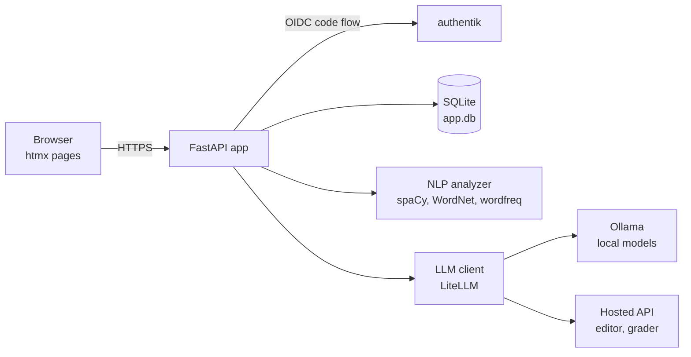

## Purpose and scope

vocab-coach is a writing coach. It helps a person replace vague, general English words ("good", "fix", "big problem", "really hard") with precise ones.

The target user is a non-native English speaker who works in English and wants to write with more precise and richer vocabulary: emails, chat messages, status updates, reviews and documents. This user usually knows many words passively but falls back on a small set of safe ones when writing. The app therefore focuses on moving words from recognition into active use, and on the fine distinctions between near-synonyms that non-native writers find hardest. Spoken practice (voice input, pronunciation, timed replies) is out of scope for now, because typed text gives the user time to think, so it measures written vocabulary and not spoken fluency.

It has three practice modes today:

- **Conversation.** The user chats with an AI partner. After each user reply, an editor model reviews the reply and suggests at most two more precise word choices, explaining how each option changes the meaning.
- **Rewrite drills.** The app generates a short context plus a vague sentence that targets one word group, the user rewrites it with optional hints, and a grader model scores the rewrite against a fixed rubric. Drills run in sets of five with a server-side summary; disputed grades are recorded as events and exported by CLI.
- **Choose the word.** A recognition exercise: a short situation, a sentence with one blank, and candidates from one precision group. The user marks every candidate that fits and picks the best one. Grading compares against a stored answer, with no grading LLM call.

Two more practice modes are planned and described in "Planned practice modes": comparing near-synonyms, and idioms.

Accepted suggestions become spaced-repetition cards. The partner steers later conversations towards topics where due words fit, so the user practises them in their own sentences. A dashboard shows which words the user overuses and whether learned words are showing up unprompted in later replies.

The app starts as a personal tool with one user and is designed so it can become a multi-user product without rewriting the data layer. This document describes the design. The build order lives in `docs/PLAN.md`, and the working rules for Claude Code live in `CLAUDE.md`.

Library versions in this document were checked on 10 Nov 2026 by installing them into a Python 3.13 virtual environment. Claims about authentik and LiteLLM behaviour were checked against their documentation on the same date.

## Stack

| Concern | Choice | Version checked | Why |
|---|---|---|---|
| Language | Python | 3.13 | The NLP libraries (spaCy, NLTK WordNet, wordfreq) are Python, so analysis runs in-process |
| Package manager | uv | 0.11.32 | Lockfile with hashes; see "Supply-chain precautions" |
| Web framework | FastAPI | 0.162.2 | Async, dependency injection makes auth and test overrides simple |
| Server | uvicorn | 0.54.0 | Standard ASGI server for FastAPI |
| Templates | Jinja2 | 3.1.6 | Fallback pages and admin; attribution |
| SPA UI | React + Vite | React 19 / Vite 8 | Hash-routed SPA in `frontend/`; talks to `/api` with the same session cookie |
| Interactivity | React SPA (Vite) + JSON `/api` | React 19 | Product UI. Legacy HTML paths redirect to `/#/...`. About and lexicon admin stay Jinja |
| Charts | Chart.js | 4.6.1 | Dashboard charts in the SPA via react-chartjs-2; also vendored for Jinja |
| Streaming | sse-starlette | 3.7.0 | Server-sent events for partner replies |
| Database | SQLite through SQLAlchemy | SQLAlchemy 2.1.8 | Single file for the personal phase; SQLAlchemy keeps a later Postgres move to a configuration change plus a data copy |
| Migrations | Alembic | 1.20.1 | Run with `render_as_batch=True` because SQLite cannot alter most column properties in place |
| Settings | pydantic-settings | 2.16.2 | Typed configuration from environment variables and `.env` |
| LLM access | LiteLLM | 1.108.4 | One interface for Ollama and hosted APIs, so a model change is a configuration change |
| Agent workflows | LangGraph | 1.2.x | Orchestrates role calls (editor, partner stream, judges, drills); nodes still call LiteLLM through `vocab.llm.client` |
| Identity | authentik (self-hosted, Docker Compose) | docs version 2026.8 | Login, sign-up and sessions through OpenID Connect |
| OIDC client | Authlib (Starlette integration) | 1.9.5 | Authorization code flow handled on the server, with the session in a signed cookie |
| NLP | spaCy with `en_core_web_sm` | 3.8.18 | Tokens, lemmas and parts of speech |
| Lexical data | NLTK WordNet 3.0 + Free Dictionary API + Datamuse | NLTK 3.10.4 / httpx | WordNet for senses and POS checks offline; free synonym APIs for editor prompt hints |
| Word frequency | wordfreq | 3.1.1 | Zipf frequency for spotting very common words and for the overuse baseline |
| Spaced repetition | fsrs | 6.3.2 | FSRS scheduler; `Card.to_dict()` and `Card.from_dict()` make storage in a JSON column simple |
| Tests | pytest | 9.2.0 | |

#### Why the SPA still sits behind FastAPI

The OIDC login and session cookie stay on the FastAPI process. The React SPA is built with Vite into `frontend/dist`, served from `/`, and calls JSON routes under `/api` with that same cookie. No tokens live in localStorage. Hash routing is the product UI; old HTML page paths redirect into `/#/...`. About and lexicon admin stay server-rendered.

#### Why SQLite now and what keeps Postgres possible

SQLite is enough for one user and needs no server. Three rules keep a later move to Postgres cheap. All queries go through SQLAlchemy, with no raw SQLite-specific SQL. Identifiers are UUIDs generated in Python, not database autoincrement. JSON columns use SQLAlchemy's `JSON` type, which maps to `TEXT` on SQLite and `JSONB` on Postgres. authentik already runs its own PostgreSQL container, but the app does not share it: identity data and app data stay in separate databases.

## Architecture



#### Modules inside the app

| Module | Responsibility |
|---|---|
| `auth` | OIDC login and logout, the `identities` mapping, the current-user dependency, and the `authorize()` function |
| `llm` | The only place that calls LiteLLM. Maps roles (`partner`, `editor`, `usage_judge`, `drill_gen`, `drill_grade`, `group_gen`, `choice_gen`, `confusable_gen`, `idiom_gen`) to model strings, loads versioned prompts, validates structured output, and records every call in `llm_calls` |
| `nlp` | Tokenises a message, counts lemmas, marks candidate vague words, and finds uses of learned words |
| `lexicon` | Word sets (precision, confusable, idiom): loading YAML seeds, drafting with LLMs, and the review queue |
| `editor` | Turns one user message into at most two suggestions linked to precision groups |
| `conversation` | Conversations, messages, the partner reply stream, and the chat pages |
| `practice` | FSRS cards, due-word selection for the partner, and recording learned-word usage |
| `drills` | Generating and grading rewrite drills |
| `exercises` | Shared recognition items (choose the word now; compare and idioms later) |
| `metrics` | Dashboard queries and calculations |
| `events` | Typed event definitions and a single `record_event()` function |

## One message through the system

This walks one user reply through every step, using the same sentence throughout.

The user is in a conversation. The partner's last message was "How did the database migration go last week?" The user replies:

> Yeah the migration was really hard and we had a big problem with the old data, but we fixed it in the end.

**Step 1: store the message.** The app inserts a `messages` row with `role=user` and `word_count=22`.

**Step 2: analyse.** The `nlp` analyzer runs spaCy on the text. It writes lemma counts to `message_lemma_counts` (for example `fix: 1`, `hard: 1`, `big: 1`, `really: 1`, `problem: 1`). It then marks candidate spans. A span is a candidate when its lemma appears in the crutch list in `data/crutch_words.yaml`, or when the token is an adjective or adverb with a wordfreq Zipf frequency of 5.5 or more. Verbs are marked only through the crutch list, because the frequency rule would otherwise mark `have` and `be` in almost every sentence (spaCy tags `had` here as a `VERB` with lemma `have`, Zipf 6.71). The frequency rule also skips a small stoplist of function adverbs (`not`, `so`, `then`, `also`, `just`, `too`, `only`, `even`, `still`, `already`, `always`, `never`, `ever`, `here`, `there`, `now`, `yet`), because they sit above the Zipf cut and would otherwise fire in almost every sentence; crutch-list hits still mark. Here the candidates are `really hard`, `big problem` and `fixed`, plus `old` from the frequency rule (Zipf 5.75), which expands with its noun to `old data`. `migration` is not marked, and `data` is not marked on its own. The candidates are hints for the editor, not a filter: the editor may flag other words too.

**Step 3: look up precision groups.** For each candidate lemma, the app loads approved groups from `precision_groups` with their options. For `fix` it finds group `fix.repair` with options `resolve`, `patch`, `work around` and `mitigate`, each with its distinction and an example.

**Step 4: run the editor.** The app fetches free synonym hints (Free Dictionary API plus Datamuse) for each candidate lemma (soft-fail if the network is down). Those hints also pull in any approved precision groups whose options match a hint word, so the model sees more of the lexicon than head-lemma lookup alone. Then the `llm` module calls the `editor` role with the active editor prompt (currently `editor.v4`), passing the message, the conversation title, optional feedback expectations, the partner's previous message, the candidate spans, the synonym hints and the candidate groups. Feedback expectations are set when the user starts the conversation and tell the editor what specialized register or terms matter for this situation. The response is validated against the `EditorOutput` schema (see "Editor contract"). The call is recorded in `llm_calls` and the validated output in `editor_runs`.

**Step 5: anchor the suggestions.** The model returns the exact text of each span it wants to change (`"really hard"`, `"fixed it in the end"`). The app finds each string in the message and stores the character offsets itself. A suggestion whose text cannot be found in the message is dropped and logged, because a model cannot be trusted to count characters. The editor returned three suggestions, but the app keeps the first two because of the per-message limit.

**Step 6: show the feedback.** The SPA loads `/api/.../feedback` and renders a separate wording-feedback panel under the user's message (idempotent: one editor run per message). Each suggestion shows the original words, up to three options with their meanings, and the clarifying question if there is one ("Was it hard because it took long, or because it was complicated?"). The app records a `suggestion_shown` event for each suggestion on first analysis only.

**Step 7: the user accepts an option.** The user clicks `resolve` under "fixed it in the end". The app records `suggestion_accepted` with `option_id` for `fix.repair/resolve` and creates an FSRS card for that option if the user does not have one yet.

**Step 8: the partner replies.** In parallel with steps 2 to 7, the partner reply streams over SSE. The partner prompt includes the user's due words as topics to steer towards, with the instruction not to use those words itself.

**Step 9: a later conversation.** A week later the card for `resolve` is due. The partner asks about a recent incident, and the user writes "we mitigated it with a rate limit and resolved it the next day". The analyzer finds the lemmas `mitigate` and `resolve` in the user's learned options. Neither word appeared in the partner's last three messages or in any suggestion shown in the last five user turns, so both are marked unprompted. The `usage_judge` role confirms that both are used in the right sense. The app records two `word_used` events with `prompted=false` and `correct=true`, and reviews both FSRS cards with rating `Good`.

## Data model

All IDs are UUIDv4 strings generated in Python. Every table holding a user's data has a `user_id` column with an index, even in the single-user phase, so that every query can filter by user and a user's data can be exported or deleted as a unit. Shared reference data (precision groups and options) has no `user_id`.

#### Identity

| Table | Columns | Notes |
|---|---|---|
| `users` | `id`, `display_name`, `email`, `created_at`, `deleted_at` | The internal user. Every other table references `users.id` |
| `identities` | `id`, `user_id`, `issuer`, `subject`, `created_at` | Unique on `(issuer, subject)`. Maps an OIDC identity to an internal user, so changing identity provider never changes `users.id` |

#### Conversation

| Table | Columns | Notes |
|---|---|---|
| `conversations` | `id`, `user_id`, `title`, `feedback_expectations` (nullable), `flow_mode` (boolean, default false), `allow_idioms` (boolean, default false), `created_at` | `title` is the conversation name/scenario. Optional `feedback_expectations` steers the editor toward domain vocabulary for that thread. `flow_mode` and `allow_idioms` are set at creation and not changed later. In flow mode the editor runs only on recap, so `suggestion_shown` is not recorded during the chat |
| `messages` | `id`, `conversation_id`, `user_id`, `role` (`user` or `partner`), `content`, `word_count`, `created_at` | `word_count` is the denominator for crutch rate |
| `message_lemma_counts` | `message_id`, `user_id`, `lemma`, `surface`, `count` | Written by the analyzer for user messages only. Feeds crutch rate and overuse lift |

#### Lexicon (shared reference data)

| Table | Columns | Notes |
|---|---|---|
| `precision_groups` | `id` (slug such as `fix.repair`, `confusable.imply-infer`, `idiom.agree`), `kind` (`precision`, `confusable` or `idiom`, default `precision`), `head_lemma` (nullable), `pos`, `sense_gloss`, `status` (`draft` or `approved`), `source` (`seed`, `llm`, `review`), `created_at` | Precision and idiom sets keep a head lemma; confusable sets leave it null |
| `precision_options` | `id`, `group_id`, `word`, `distinction`, `example`, `register` (`neutral`, `formal`, `technical`), `details` (JSON, nullable), `status` | `details` is validated by kind: empty for precision; confusable and idiom fields below |
| `review_queue` | `id`, `editor_run_id`, `head_lemma`, `proposed_word`, `distinction`, `example`, `status` (`pending`, `approved`, `rejected`), `created_at` | Options the editor proposed that are not in the lexicon yet |

#### Editor output

| Table | Columns | Notes |
|---|---|---|
| `editor_runs` | `id`, `message_id`, `user_id`, `llm_call_id`, `output` (JSON), `created_at` | The validated editor output, kept for debugging and evals |
| `suggestions` | `id`, `editor_run_id`, `message_id`, `user_id`, `original_text`, `span_start`, `span_end`, `group_id` (nullable), `question` (nullable), `rank` | Offsets are computed by the app, not the model |
| `suggestion_options` | `id`, `suggestion_id`, `option_id` (nullable), `word`, `meaning`, `rank` | `option_id` is null when the editor proposed a word outside the lexicon |

#### Practice and drills

| Table | Columns | Notes |
|---|---|---|
| `srs_cards` | `id`, `user_id`, `option_id`, `fsrs_card` (JSON from `Card.to_dict()`), `due_at`, `created_at` | Unique on `(user_id, option_id)`. `due_at` is copied out of the JSON so it can be indexed |
| `drills` | `id`, `user_id`, `group_id`, `vague_sentence`, `context` (nullable), `intended_option_id`, `intended_word`, `llm_call_id`, `created_at` | Intended option comes from `drill_gen`. `context` is set by prompt v2 and null for older drills |
| `drill_attempts` | `id`, `drill_id`, `user_id`, `answer`, `grade` (JSON), `score`, `hints_used` (default 0), `llm_call_id`, `created_at` | Hints do not change the score; they are shown with the grade |
| `exercises` | `id`, `user_id`, `group_id`, `item_type`, `prompt` (JSON), `answer` (JSON), `llm_call_id`, `created_at` | Shared by choose the word, compare and idiom steps. `item_type` starts with `choice`. `prompt` is what the user sees; `answer` is never sent before the attempt |
| `exercise_attempts` | `id`, `exercise_id`, `user_id`, `response` (JSON), `correct`, `feedback` (JSON), `created_at` | `correct` comes from a pure grading function per `item_type` |

#### Events and LLM calls

| Table | Columns | Notes |
|---|---|---|
| `events` | `id`, `user_id`, `type`, `subject_type`, `subject_id`, `payload` (JSON), `created_at` | Append-only in normal operation. Deletable by `user_id` for account deletion |
| `llm_calls` | `id`, `user_id` (nullable), `role`, `model`, `prompt_id`, `prompt_version`, `input_tokens`, `output_tokens`, `cost_usd`, `latency_ms`, `status`, `error`, `created_at` | Every LLM call, including failures |

Event types and their payloads are defined as Pydantic models in `events.py`:

| Event type | Subject | Payload |
|---|---|---|
| `suggestion_shown` | suggestion | `group_id` |
| `suggestion_accepted` | suggestion | `option_id` (nullable), `word` |
| `suggestion_dismissed` | suggestion | none |
| `suggestion_retried` | suggestion | `option_id` (nullable), `word` |
| `word_used` | message | `option_id`, `correct`, `prompted`, `judge_call_id` |
| `card_reviewed` | srs card | `rating`, `source` (`conversation`, `drill`, `review_page`, `exercise`), `option_id` |
| `drill_graded` | drill attempt | `score`, `rubric` scores |
| `drill_disputed` | drill attempt | `note` (nullable) |
| `exercise_answered` | exercise attempt | `item_type`, `correct`, `option_id` (nullable, the option the item tested) |

Metrics are computed from `events`, `messages` and `message_lemma_counts`. The `srs_cards` table holds current scheduler state for fast lookup, and it can be rebuilt by replaying `card_reviewed` events.

## LLM layer

#### Roles, not model names

Application code asks for a role, never a model. LangGraph workflows in `vocab.llm.graphs` orchestrate those roles (structured calls, partner streaming, multi-hit usage judging). Nodes still call `complete` / `stream`, which talk to LiteLLM. `config.py` maps roles to LiteLLM model strings, for example:

```env
# Provider API keys (LiteLLM reads these from the environment):
OPENAI_API_KEY=...
ANTHROPIC_API_KEY=...
GEMINI_API_KEY=...

# Model strings are provider/model, one per role. Examples:
LLM_EDITOR_MODEL=openai/gpt-4o
LLM_PARTNER_MODEL=anthropic/claude-sonnet-4-5-20250929
LLM_USAGE_JUDGE_MODEL=gemini/gemini-2.0-flash
# Or local:
LLM_PARTNER_MODEL=ollama_chat/llama3.2
OLLAMA_API_BASE=http://localhost:11434
```

Copy `.env.example` to `.env`, set the key for the provider you use, and uncomment that provider's model block. Roles can mix providers. Use `uv run vocab llm ping <role>` to check a role. Pick models with the editor eval when quality matters.

#### FakeLLM (tests only)

`FakeLLM` is not a runtime setting and is not redundant. Unit tests install it with `use_fake(...)` so pytest never calls a real provider. Production always uses LiteLLM and your API keys. Remove FakeLLM only if you are willing to make every unit test hit the network.

#### Structured output

Roles that return JSON (`editor`, `usage_judge`, `drill_gen`, `drill_grade`, `group_gen`, `choice_gen`, `confusable_gen`, `idiom_gen`) define a Pydantic model for the output. The client decides how to request it:

- If `litellm.supports_response_schema(model=..., custom_llm_provider=...)` returns true, pass the Pydantic class as `response_format`.
- Otherwise pass `response_format={"type": "json_object"}` and put the JSON schema in the prompt.

In both cases, validate the reply with `Model.model_validate_json(...)`. On a validation error, retry once with the error message appended to the conversation, then record the call as failed.

I checked this with LiteLLM 1.108.4: `supports_response_schema` returns `True` for hosted models such as `gpt-4o-mini` and `False` for `ollama_chat/...` and `ollama/...` model strings, while `response_format` still appears in `get_supported_openai_params` for the Ollama models. So code that assumes schema support everywhere will behave differently on local models, and the fallback path above is required.

#### Prompts are versioned files

Prompts live in `src/vocab/prompts/` as Markdown files named `<role>.v<N>.md`. A prompt file is never edited after it has been used for recorded data. A change means a new file (`editor.v2.md`) and a configuration change. Every `llm_calls` row records `prompt_id` and `prompt_version`, so a shift in acceptance rate can be traced to a prompt or model change instead of being mistaken for user progress.

#### Testing without a model

LiteLLM's `completion` accepts `mock_response`, which returns the given text without calling any provider (checked with 1.108.4). Unit tests use a fake client that returns fixture JSON. A small set of integration tests, marked `@pytest.mark.llm` and skipped by default, call the real configured models.

## Editor contract

#### Input

- The user's message.
- The partner's previous message, for context.
- Candidate spans from the analyzer: text, lemma, part of speech, and why each was marked.
- Synonym hints from free APIs for those lemmas (optional inspiration; never shown raw to the user).
- Approved precision groups for the candidate lemmas (plus groups matched via hint words), with each option's word, distinction and example.

#### Output schema

```python
from pydantic import BaseModel, Field


class EditorOption(BaseModel):
    word: str
    meaning: str = Field(description="What this word says that the original does not")
    option_id: str | None = Field(
        default=None, description="ID from the supplied groups, or null for a new word"
    )


class EditorSuggestion(BaseModel):
    original: str = Field(description="Exact substring of the user's message")
    group_id: str | None
    options: list[EditorOption] = Field(min_length=1, max_length=3)
    question: str | None = Field(
        default=None, description="Ask when the right word depends on facts you do not know"
    )
    why: str = Field(description="One sentence on what is vague about the original")


class EditorOutput(BaseModel):
    overview: str = Field(
        description="One or two sentences on how the whole message reads"
    )
    suggestions: list[EditorSuggestion] = Field(max_length=3)
    keep: list[str] = Field(
        description="Words that looked like candidates but are already the right word"
    )
```

The schema allows three suggestions so the app can drop one that fails anchoring and still show two. The UI colour-marks each spot in the message and keeps other suggestions open after you accept one.

#### Rules the editor prompt must state

- Keeping the original word is a valid outcome. Suggest a change only when an option says something more specific that is true of the situation.
- Never suggest a longer word that means the same thing ("utilise" for "use", "facilitate" for "help", "leverage" for "use").
- Every option must fit the sentence grammatically and keep the user's intended meaning.
- When the right option depends on facts the message does not give, ask a question instead of guessing.
- Prefer options from the supplied groups. Propose a new word only when none of them fits, and set `option_id` to null.
- Treat synonym-API hints as optional inspiration, not a list to copy.
- When two or more candidate spans are vague in context, return two suggestions on different originals (three max).
- `original` must be copied exactly from the message.

#### Usage judge

The usage judge runs only when the analyzer finds a learned option's lemma in a user message. It receives the sentence, the word, and the option's distinction, and returns `{"correct": bool, "explanation": str}`. Keeping it separate from the editor keeps the editor prompt focused and makes misuse rate measurable on its own.

## Partner contract

The partner holds a natural conversation. Its system prompt includes a topic or scenario chosen by the user (the conversation name), and up to three due words. The prompt tells the partner to steer towards situations where those words would fit, never to use the due words itself, never to correct the user's English, and to keep replies short so the user writes more than the partner does. Not using the due words matters for the metrics: a word the partner just used does not count as unprompted when the user repeats it. The user may also store optional feedback expectations on the conversation; those go to the editor, not the partner, so wording feedback can prefer specialized terms for that situation.

## Precision groups

The lexicon holds three kinds of word set in the same tables: precision groups (vague head lemma to precise options), confusable sets (near-synonyms with no vague head), and idiom sets (phrases grouped by the plain word they can replace). Queries that feed the editor or rewrite drills filter on `kind="precision"`. Idiom groups reach the editor only under the limits in "Idioms" (not built yet). Cards, usage detection and metrics keep working on `option_id` for every kind.

Groups are seeded from YAML files in `data/precision_groups/`. A missing top-level `kind` means `precision`. Confusable files use ids such as `confusable.imply-infer` and leave `head_lemma` empty. Idiom files use ids such as `idiom.agree` and set `head_lemma` to the plain word.

```yaml
head_lemma: fix
groups:
  - id: fix.repair
    pos: VERB
    sense_gloss: make a broken or faulty thing work again
    options:
      - word: resolve
        distinction: the cause is removed, so the problem will not come back
        example: We resolved the timeout by fixing the connection pool size.
        register: neutral
      - word: patch
        distinction: a targeted change, often quick and possibly temporary
        example: We patched the parser to skip malformed rows.
        register: technical
      - word: work around
        distinction: the cause remains but is avoided
        example: We worked around the bug by retrying the request.
        register: neutral
      - word: mitigate
        distinction: the harm is reduced but not removed
        example: The rate limit mitigates the overload.
        register: neutral
```

Option `details` by kind:

- Precision: leave empty.
- Confusable: `collocations` (list of strings), `connotation` (`positive`, `neutral`, `negative`), optional `strength` (integer when the set has a natural order).
- Idiom: `meaning`, `tier` (`everyday` or `literary`), `region` (`common`, `uk`, `us`), `variants`, `misuse_example`, `avoid_when`, and for literary idioms a one-sentence `origin`. The option `word` holds the idiom in base form ("cut corners"); lemma matching covers inflected forms such as "cutting corners".

The lexicon grows in three ways. `uv run vocab lexicon draft <lemma>` asks `group_gen` for precision drafts. `uv run vocab lexicon draft --kind confusable --words imply,infer` asks `confusable_gen`, and `--kind idiom --lemma agree` asks `idiom_gen`. Editor proposals with `option_id` null go into `review_queue`. An admin page lists drafts, approved sets (with kind and details) and queued proposals with approve, edit and reject actions. Only approved precision groups are given to the editor today.

WordNet is used for candidate senses and for checking that a proposed word exists with the right part of speech. It is not used as the source of suggestions, because its synonym lists are context-free: for "fix" they include "cook", "pickle" and "desex", and they do not include "resolve", "remedy", "rectify" or "mitigate" (checked against WordNet 3.0 through NLTK 3.10.4).

Free Dictionary API (`dictionaryapi.dev`) and Datamuse (`api.datamuse.com`) supply synonym *hints* into the editor prompt the same way: the model must still choose words that fit the sentence, prefer approved precision groups, and never dump the hint list. If both are unreachable the editor still runs with empty hints.

## Planned practice modes

This section describes features that are planned in `docs/PLAN.md` but not built yet. They all reuse the lexicon, the FSRS cards and the event log, so a word learned in any mode is reviewed and measured in the same way.

#### Choose the word

Built. The user sees a short situation, a sentence with one blank, and four to six candidate words from one group. They mark every candidate that fits and then pick the best one. The feedback explains each candidate in one line: why it fits, why it only partly fits, or why it is wrong. The `choice_gen` role writes the item, including which candidates fit and a short reason for each, so grading is a comparison against stored answers and needs no grading LLM call. Items live in the shared `exercises` tables with `item_type="choice"`. A correct best pick for a carded option reviews that card with `Good` and source `exercise`.

#### Compare

A compare card shows two to four near-synonyms side by side: the core difference in one sentence, the connotation, the register, typical collocations, and one example sentence per word. For example, *persuade* is about getting someone to act and *convince* is about getting someone to believe. Practice uses three item types:

- A pair of sentences where only one of the words fits each sentence.
- A sentence that misuses one of the words, where the user names the misused word and the replacement.
- Ordering a set by strength, such as annoyed, irritated, exasperated, livid.

Confusable sets are the main source for this mode, and precision groups can be shown as compare cards too.

#### Idioms

Idioms are split into two tiers. The everyday tier holds idioms common in workplace writing ("cut corners", "a long shot"). The literary tier holds allusions that well-read writers use ("Pyrrhic victory", "Hobson's choice"), and each one gets its origin because the story helps the user remember the meaning. The everyday tier is built first, because it matches the target user's daily writing.

A user learns an idiom in steps: recognise it in a short paragraph, choose its meaning, pick the situation where it fits, write it in their own sentence (graded), and finally use it unprompted in a conversation, which the existing usage detection records as a `word_used` event.

A misused idiom reads worse than a plain word, especially from a non-native writer, so idioms have extra limits:

- Every idiom stores `avoid_when`, and the card shows it.
- Conversations get an `allow_idioms` flag, off by default and set by the writing-task presets (on for a team chat update, off for a client email). The editor receives idiom groups only when the flag is on and no idiom suggestion has been shown in that conversation yet, so it can suggest at most one idiom per conversation.
- Misuse rate is reported separately for idioms, and the dashboard does not reward a higher count of idioms used.

Idiom content is drafted by an `idiom_gen` role and reviewed in the admin page, like precision groups. Entries are not copied from published dictionaries, because of licensing. The first three steps are exercises written by `compare_gen` (see the next subsection). The fourth step is graded by the existing `usage_judge`, with the idiom's `meaning` passed as the distinction.

#### Planned tables, events and roles

The shared `exercises` / `exercise_attempts` tables, `exercise_answered`, `card_reviewed.source=exercise` and the `choice_gen` role are built (see "Data model" and "Choose the word"). Compare and the first three idiom steps add more `item_type` values on those tables.

Lexicon `kind` / nullable `head_lemma` / option `details`, plus `confusable_gen` and `idiom_gen`, are built (see "Data model" and "Precision groups").

New LLM roles still planned: `compare_gen`. It needs a model setting and a prompt version setting like the existing roles.

## Practice and spaced repetition

Each accepted option becomes an FSRS card for that user. Ratings come from real use where possible:

| What happened | FSRS rating |
|---|---|
| The user used the word unprompted and the judge marked it correct | `Good` |
| The user used the word correctly in a drill | `Good` |
| The user picked the correct best option in a choose-the-word exercise | `Good` |
| The judge marked a use incorrect | `Again` |
| The user rated a card on the review page | The rating they chose |

A word that is due but not used in a session receives no rating and stays due. The partner receives up to three due words per conversation, ordered by how overdue they are.

A word use counts as prompted when the same lemma appeared in any of the partner's last three messages, or in a suggestion shown to the user in their last five messages. Prompted uses still create `word_used` events but do not count towards spontaneous use and do not review the card.

## Metrics

All metrics are computed per user over a time window (default: weekly buckets for the last twelve weeks).

| Metric | Definition | Notes |
|---|---|---|
| Crutch rate | 1000 × (occurrences of crutch-list lemmas in user messages) ÷ (total words in user messages) | The headline number. Also shown per lemma |
| Overuse lift | For each surface word with at least five uses: (user's uses ÷ user's total words) ÷ `wordfreq.word_frequency(word, "en")` | Shows words the user uses far more than general English. Surface forms are used because wordfreq counts surface forms |
| Acceptance rate | `suggestion_accepted` ÷ `suggestion_shown` | A low rate points at editor quality, not at the user |
| Spontaneous correct use | Accepted options with at least one unprompted, correct `word_used` event within 30 days of acceptance ÷ options accepted in that window | The main evidence that a word has entered active vocabulary |
| Misuse rate | `word_used` with `correct=false` ÷ all `word_used` | Guards against scattering new words incorrectly |
| Drill score | Mean drill score per week | Rubric: precision, correctness of meaning, naturalness, each 1 to 5 |
| Lexical diversity | MTLD over all user words in the window, reported only when the window has at least 100 words | Type-token ratio is avoided because it falls as text gets longer |

MTLD is implemented in `metrics/lexical.py` (the algorithm is about thirty lines: a forward and a backward pass counting how many word sequences it takes for the type-token ratio to fall to 0.72). This avoids an extra dependency.

Average word rarity is not a metric. It rewards replacing plain words with rare synonyms, which is the inflated style the app is meant to discourage.

## Authentication and authorization

#### Login with authentik

authentik runs from its official Compose file in `infra/authentik/`. Its docs (version 2026.8) list at least 2 CPU cores and 2 GB of RAM, and the setup generates `PG_PASS` and `AUTHENTIK_SECRET_KEY` into `.env`. It listens on port 9000 for HTTP, and the first visit to `http://localhost:9000` asks for a password for the `akadmin` user.

In authentik, create an OAuth2/OpenID provider and an application with the slug `vocab-coach`. authentik's per-provider issuer is `https://<authentik-host>/application/o/<application_slug>/` and the discovery document is at `/application/o/<application_slug>/.well-known/openid-configuration`. Set the redirect URI to exactly `http://localhost:8000/auth/callback`. Do not leave the field empty: according to the docs, an empty field makes authentik save whichever redirect URI the first login uses.

The app uses Authlib's Starlette client:

```python
from authlib.integrations.starlette_client import OAuth

oauth = OAuth()
oauth.register(
    name="authentik",
    server_metadata_url=f"{settings.oidc_issuer}.well-known/openid-configuration",
    client_id=settings.oidc_client_id,
    client_secret=settings.oidc_client_secret,
    client_kwargs={"scope": "openid email profile"},
)
```

`settings.oidc_issuer` ends with a slash, matching authentik's issuer format. Starlette's `SessionMiddleware` stores the session in a signed cookie named `vocab_session`. A distinct name matters in development, because browsers do not separate cookies by port, so the app on `localhost:8000` and authentik on `localhost:9000` share one cookie jar.

On logout, the app clears its own session and redirects to the provider's `end_session_endpoint`. The app sends no `id_token_hint`, because the session holds only `user_id`; authentik accepts that (checked against authentik 2026.8.5). The provider's invalidation flow must be `default-invalidation-flow`. The `default-provider-invalidation-flow` only shows "you have logged out of vocab-coach" and leaves the authentik session alive, so the next visit would log in again without asking for credentials. `infra/authentik/blueprints/vocab-coach.yaml` sets this, along with `grant_types: [authorization_code]`, which is empty by default in this version and makes authentik reject the authorize request.

On callback, the app reads `iss` and `sub` from the validated ID token, looks up `identities`, creates a `users` row and an `identities` row if none exists, and stores only the internal `user_id` in the session.

#### Authorization

Every route that touches user data gets the current user from a FastAPI dependency and passes resource access through `authorize(user_id, action, resource)`. This function checks that the resource's `user_id` equals the caller's. authentik handles identity. Cross-user roles (coach, organisation admin) are not part of the personal phase, so there is no separate authorization service.

There is no runtime switch that disables authentication. Tests replace the current-user dependency with `app.dependency_overrides`.

## Configuration

| Variable | Example | Purpose |
|---|---|---|
| `APP_ENV` | `dev` | `dev`, `test` or `prod` |
| `DATABASE_URL` | `sqlite:///./data/app.db` | SQLAlchemy URL |
| `SESSION_SECRET` | 64 random hex characters | Signs the session cookie |
| `OIDC_ISSUER` | `http://localhost:9000/application/o/vocab-coach/` | authentik provider issuer, with trailing slash |
| `OIDC_CLIENT_ID`, `OIDC_CLIENT_SECRET` | from authentik | |
| `LLM_*_MODEL` | see "Roles, not model names" | One per role |
| `LLM_*_PROMPT_VERSION` | `1` | Active `prompts/<role>.v<N>.md` per role |
| `OLLAMA_API_BASE` | `http://localhost:11434` | |
| Provider API keys | as LiteLLM expects, for example `ANTHROPIC_API_KEY` or `OPENAI_API_KEY` | Read by LiteLLM from the environment |
| `EDITOR_MAX_SUGGESTIONS` | `2` | |
| `ADMIN_USER_ID` | a `users.id` | Who may open `/admin/lexicon`; empty denies all |
| `LLM_RATE_LIMIT_PER_DAY` | `200` | Max `llm_calls` rows per user in 24h; `0` disables |
| `LLM_COST_LIMIT_USD_PER_DAY` | `5.0` | Max summed `cost_usd` per user in 24h; `0` disables |
| `LLM_PRIVACY_NOTE` | plain sentence | Text shown on `/about/privacy` |

SQLite connections set `PRAGMA foreign_keys=ON` and `PRAGMA journal_mode=WAL` in a SQLAlchemy `connect` event listener. SQLite does not enforce foreign keys unless the pragma is set on each connection.

## Supply-chain precautions

On 24 March 2026, LiteLLM versions 1.82.7 and 1.82.8 were published to PyPI with credential-stealing code after a maintainer's publishing credentials were compromised. The compromised versions were removed. Because this app holds API keys in its environment:

- Dependencies are pinned in `uv.lock`, which records hashes, and installed with `uv sync --locked`.
- Upgrades are deliberate (`uv lock --upgrade-package <name>`) and reviewed, never automatic on install.
- API keys live in `.env`, which is git-ignored, and are never logged. `llm_calls` stores no request headers.

## Licences and attribution

| Component | Licence | Obligation |
|---|---|---|
| spaCy | MIT | Keep the licence notice |
| NLTK | Apache 2.0 | Keep the licence notice |
| WordNet 3.0 data | Princeton WordNet licence | Include Princeton's copyright notice with copies; do not use Princeton's name in advertising |
| wordfreq | Code Apache 2.0; data files CC BY-SA 4.0, with source-specific credits such as SUBTLEX | Add an attribution page. Get advice before redistributing the frequency data itself |
| authentik | MIT core; `authentik/enterprise/` under a separate licence | Read the enterprise licence before a commercial launch |

An `/about/attribution` page lists these from the start.

## What you see and what is causing it

| What you see | What is causing it |
|---|---|
| Login redirects to an authentik error about the redirect URI | The redirect URI in authentik does not match `http://localhost:8000/auth/callback` exactly, including scheme and port |
| Logging in to authentik logs you out of the app, or the reverse | Both use the same cookie name on `localhost`; browsers do not separate cookies by port |
| Discovery fails with a 404 | `OIDC_ISSUER` is missing its trailing slash, so the discovery URL is built wrongly |
| Editor output fails validation only on local models | LiteLLM reports no schema support for Ollama models, so the `json_object` fallback with the schema in the prompt must be used |
| Suggestions are highlighted on the wrong words | Character offsets were taken from the model instead of found by the app |
| Acceptance rate jumps after a deploy | The editor model or prompt changed; compare by `prompt_version` and `model` in `llm_calls` |
| Deleting a conversation leaves orphaned messages | SQLite foreign keys are off because `PRAGMA foreign_keys=ON` was not set on the connection |
| An Alembic migration fails with "near ALTER: syntax error" | Batch mode is off; SQLite needs `render_as_batch=True` to change columns |
| A user's repeated word counts as spontaneous use | The partner used the word first; the prompted check or the partner prompt rule is missing |
| Overuse list is full of "the" and "is" | Raw counts are shown instead of lift against wordfreq |
| Lemma counts show `datum` where the user wrote "data" | spaCy's English lemmatizer maps "data" to `datum` (checked with `en_core_web_sm` for spaCy 3.8.18); show surface forms in the UI and use lemmas only for matching |
